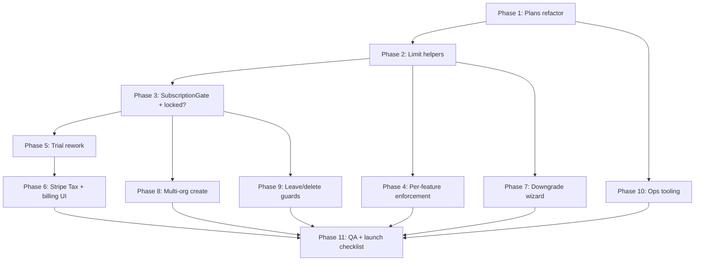

# Production launch: tiers, trial, multi-org

Design for the final pre-launch billing/tier overhaul: two GBP-only plans, a no-card 30-day trial,
hard lockout on lapsed payment, per-plan feature limits, multi-organization support for chain
owners, and account/org deletion protections tied to subscription state.

**Status: Phases 1–10 complete. Next up: Phase 11 (QA & launch gate).**

## Contents

- [1. Overview](#1-overview)
- [2. Pricing & tiers](#2-pricing--tiers)
- [3. Trial mechanics](#3-trial-mechanics)
- [4. Lapsed payment / lockout](#4-lapsed-payment--lockout)
- [5. Feature & limit matrix](#5-feature--limit-matrix)
- [6. Multi-organization support](#6-multi-organization-support)
- [7. Leaving an org / deleting an account](#7-leaving-an-org--deleting-an-account)
- [8. Data model changes](#8-data-model-changes)
- [9. Assumptions & open questions](#9-assumptions--open-questions)
- [10. Non-application launch readiness](#10-non-application-launch-readiness)
- [11. Build approach & rollout](#11-build-approach--rollout)
- [12. Implementation checklist](#12-implementation-checklist)

---

## 1. Overview

Today (`app/models/billing/plans.rb`) there are three plans (Free/Starter/Growth), priced in both
USD and GBP, differing only by `member_limit` and a `custom_domain` flag — every other product
feature is available on every plan (`docs/rewrite-plan.md`: *"All product features available on
every billing plan for now - tier-based limits come later"*). This doc is that "later."

Target state:

- **Two plans only**: Starter (£9.99/mo ex VAT) and Business (£29.99/mo ex VAT, renamed from Growth). No Free
  tier, no USD pricing.
- **Trial replaces Free**: every account's first organization gets a 30-day trial with no card
  required. There is no ongoing free tier to fall back to — when the trial ends, the org must have
  an active paid subscription or the app locks for that org.
- **Starter is feature-limited**, not just seat-limited: request volume, service count, upsell
  rules, users, audit log retention, and entire feature areas (appointments, kiosk) are capped or
  disabled. Business is unlimited/fully unlocked.
- **Multi-org**: an owner can spin up additional organizations under the same account (chain
  locations). Only the account's *first ever* organization gets the 30-day trial — every
  subsequently created org must be paid (or locked) from creation.
- **Deletion/leave protection**: a user can't leave an org as its last member, or delete their own
  account, while any org they'd be abandoning has an active (non-canceled) subscription. The
  subscription must be canceled first.
- **Downgrade wizard (two paths)**: Business → Starter always runs a force-a-choice wizard when the
  org exceeds Starter limits — both when scheduling a downgrade on an active sub **and** when
  resubscribing to Starter after lockout. The post-lockout path is **mandatory and blocking** until
  complete (survives logout/browser close).

## 2. Pricing & tiers

| | Starter | Business |
|---|---|---|
| Price | £9.99/mo ex VAT | £29.99/mo ex VAT |
| Currency | GBP only | GBP only |
| Trial | 30 days, no card, first org only | 30 days, no card, first org only |
| Tax | VAT-exclusive list price; Stripe Tax adds UK VAT at checkout | VAT-exclusive list price; Stripe Tax adds UK VAT at checkout |

**Decided**: £9.99/£29.99 are the **ex-VAT** list prices shown on `/pricing`, `/billing`, and marketing copy.
Stripe Tax calculates and collects VAT **on top** of those amounts at checkout/invoice time (not baked into
the headline price). See §10 for the implementation note.

Both plans are GBP-only — the existing USD price points and the Growth-currency split in
`Billing::Plans` (`app/models/billing/plans.rb`) are removed. `Organization#preferred_currency`
either goes away or is hardcoded to `"gbp"` (see §8 for what actually needs to change there —
pending the research pass on every current reference to `member_limit`/`custom_domain`/plan keys).

"Growth" is renamed to "Business" everywhere: the `Billing::Plans` key/name, Stripe Product/Price
nicknames, credentials key (`stripe.price_ids.growth.*` → `stripe.price_ids.business.gbp`), UI
copy on `/billing`, and any hardcoded string checks (`plan.key == "growth"`).

## 3. Trial mechanics

- New behavior: **30 calendar days, no card on file.** This replaces both the current Free tier and
  the current 14-day-Starter-only trial (`Organization::TRIAL_PLAN_KEY`, `TRIAL_DAYS = 14` in
  `app/models/organization.rb`).
- Trial applies **once per account**, not once per organization: only the organization created by
  `Organization.create_personal_for!` during the account's original signup (or first OAuth
  sign-in) starts a trial automatically. Any organization created afterwards — via the new
  multi-org flow (§6) or by accepting an invite — does **not** get a trial.
    - "Once per account" needs a durable flag independent of any single org, since the trial org
      itself could later be deleted/left. Likely a `trial_granted_at` timestamp on `User`, set the
      moment the first org's trial starts, checked whenever a new org is created by that user.
- During the trial, the org behaves as if fully subscribed **to whichever plan the owner selects**
  at trial start (Starter or Business) — trials aren't a separate feature set, they're a real plan
  with deferred payment. The owner must pick a plan up front (default suggestion: Starter) so
  there's no ambiguous "which limits apply during trial" question.
- 3 days before trial end (and on the day it ends), email the org's owner(s). Reuses the existing
  `ConfirmationMailer`-style transactional mailer pattern already in the app.
- At day 30, if no payment method + active Stripe subscription exists, the org transitions to
  **locked** (§4) rather than silently downgrading to a free tier — there is no free tier to fall
  back to anymore.

## 4. Lapsed payment / lockout

Applies when: trial expires without a subscription, or an active subscription's invoice fails and
Stripe exhausts its dunning/retry schedule.

**Gap closed on review — `past_due` alone should not trigger a full lock.** `past_due` means Stripe
is actively mid-retry on a failed card (its Smart Retries schedule spans days to weeks depending on
your Stripe dashboard settings) — locking on the first failed charge would be needlessly harsh for
what's often a temporary card issue. Treat `past_due` as a **warning state**: show a persistent "your
payment failed, update your card" banner across the app (not a lock), and reserve full lockout (§4's
behavior below) for the terminal states Stripe actually settles on once retries are exhausted:
`canceled` or `unpaid`. This also means your Stripe dashboard's dunning/Smart Retries configuration
*is* effectively your grace-period setting — worth deciding how long that window is (Stripe's
default is a few weeks) rather than leaving it at whatever Stripe defaults to.

**Lock behavior: product features are blocked, account/admin surfaces stay open.** This is not a
redirect-everything-to-billing lock — a locked org's owner still needs to actually manage their way
out of the lock, so the following stay accessible:

- `/billing` in full (payment method, subscription/plan change, invoices, promo codes) — this is
  the whole point of the lock.
- Organization settings (`Org::SettingsController` — name, slug, timezone/currency, general config)
  and membership management (viewing/removing members, role changes) — locked orgs can still be
  administered, just not used operationally.
- The org switcher and creating additional organizations (§6) — a locked org shouldn't trap someone
  out of their *other*, unlocked organizations.
- Personal account settings (profile, password, 2FA, notification preferences) — these are
  user-level, not org-level, and are never affected by any single org's lock state.

Everything operational is blocked: queue/service-request creation, appointments, kiosk device
registration and kiosk sessions, calendars, services/upsell-rule configuration, and both the public
booking portal and waiting display show a "temporarily unavailable" page instead of exposing
customer data or accepting new requests. Inviting new members stays blocked too — nothing about
being locked should let an org grow past what it isn't currently paying for.

Rationale for blocking operational features rather than pure read-only: this app's core value is
queue/appointment intake — a "read-only" org that can't take new service requests isn't
meaningfully different from locked for the customer-facing pieces, but read-only would be a lot
more code to build and test (a parallel set of "except you can't create X" guards) for no real
benefit at launch. Revisit only if support requests show customers need historical data access
mid-lockout beyond what §5's audit-log visibility already gives them.

Implementation shape (pending confirmation against real controller structure from §8):

- A single `before_action` in the top-level authenticated controller (likely alongside
  `OnboardingGate`, `app/controllers/concerns/onboarding_gate.rb`) — call it `SubscriptionGate` —
  checks `Current.organization.locked?` and redirects to billing if true. Exclusions: `admin/*`
  (same as onboarding), `billing/*`, `org/settings`, `org/members`, `org/switches`,
  `org/organizations` (new, per §6), and the user-level account/profile controllers.
- **`PlanReconciliationGate`** (separate from lockout): when `Current.organization.plan_reconciliation_required?`,
  redirect every authenticated request to the downgrade wizard except billing (read-only sub view),
  the wizard routes themselves, org switcher, and logout. Evaluated **after** `locked?` is false —
  i.e. an org can go locked → pay for Starter → still blocked until wizard completes. See §5.
- `Organization#locked?` is computed, not stored: true when `trial_ends_at.past? && !active_subscription?`
  or when the Pay subscription status is `unpaid`/`canceled` (**not** `past_due` — see the gap note
  above) — mirrors the existing `over_member_limit_at` pattern of deriving state via
  `Billing::ReconcileOrganizationJob` rather than trusting client state.
- Kiosk and public-portal controllers need their own equivalent gate, since they don't inherit from
  the staff-authenticated base controller.

## 5. Feature & limit matrix

| Limit / feature | Starter | Business |
|---|---|---|
| Users (memberships) | **1** | Unlimited |
| Services | **3** | Unlimited |
| Upsell rules | **1** | Unlimited |
| Service requests (staff + online/mobile combined) | **200 / month** | Unlimited |
| Online/mobile self-service requests | Included in the 200 cap above | Unlimited |
| Appointment booking & check-in | **Disabled entirely** | Enabled |
| Kiosk devices | **Disabled entirely** (0 devices) | Enabled |
| Staff-assisted self check-in / service-request creation (non-kiosk) | **Enabled** | Enabled |
| Custom domain | Disabled (already the case for the old Starter tier) | Enabled (already the case for old Growth) |
| Audit log visibility | **Last 7 days only** (query-scoped) | Full history |

Notes:

- **"Users: 1"** is a hard change from today's `member_limit: 5` for Starter — it also means the
  invite flow (`Org::InvitationsController`) must be blocked outright on Starter once 1 member
  exists, not just capped at a higher number. Worth a UI nudge: "Invite teammates" on Starter should
  read as an upsell prompt to Business rather than a disabled button with no explanation.
- **200 requests/month is a combined cap** across staff-created and online/mobile-submitted
  requests (not 200 of each). It resets on the calendar month, not the Stripe billing cycle, so the
  reset date is predictable regardless of when the org subscribed. When the org hits 200, the
  behavior should mirror the lockout pattern (§4) scoped to just request creation: existing data
  stays visible, new `ServiceRequest#create` calls (staff or online/mobile) are blocked with an
  upgrade prompt until next reset or upgrade.
- **Appointments & kiosk are Starter-disabled features**, not just hidden UI — the underlying
  routes/controllers must reject requests server-side (not just hide nav links), since a
  determined user could otherwise hit the appointment-booking or kiosk-device-registration
  endpoints directly.
- **Audit log "retention" is a visibility window, not a deletion.** `AuditLog` rows are written and
  kept in the database regardless of plan — nothing is purged. What changes per plan is what the
  org can *query/see*: on Starter, every audit-log view/query is scoped to `created_at >= 7.days.ago`;
  on Business, unscoped. This means upgrading from Starter to Business instantly restores access to
  the org's full history (nothing was ever destroyed to lose), and it sidesteps any argument about
  needing the older data later for compliance/support/legal reasons. Likely a single scope,
  e.g. `AuditLog.visible_for(organization)`, used everywhere audit logs are currently displayed —
  no new background job needed.
- Likely mechanism: extend `Billing::Plans::Plan` (`Data.define`) with a `limits` sub-struct
  (`max_users`, `max_services`, `max_upsell_rules`, `max_monthly_requests`, `appointments_enabled`,
  `kiosk_enabled`, `audit_log_retention_days`) instead of the current ad hoc `member_limit`/
  `custom_domain` fields, so every gate reads from one place per plan rather than scattering
  `plan.key == "starter"` checks through the app.

### Downgrading Business → Starter when over Starter's limits: the choice wizard

**Decided: a force-a-choice wizard**, not a hard block. This wasn't addressed anywhere in the
original draft and was the biggest structural gap — a Business org can freely have 6 users, 10
services, 3 upsell rules, kiosk devices, and appointments in active use, all things Starter either
caps hard or disables outright.

**Governing rule for the whole wizard: downgrading never deletes anything — it only turns off
*creating new* things past the cap, or archives existing excess so it's inactive but intact.**
Re-upgrading at any point instantly restores full access, because nothing was ever destroyed. This
is the same principle already applied to audit-log visibility (§5 above) and extends cleanly to
every resource here — it's what makes the whole downgrade feel safe rather than punitive.

Clicking "Downgrade to Starter" walks the owner through only the steps that actually apply (nothing
to resolve → no step shown):

1. **Users** (if more than 1 member): no choice needed here — the owner is the one initiating a
   billing change they're responsible for, so the wizard simply states "Starter is single-user;
   every other member will be removed from this organization" and lists who. (Handing ownership to
   someone else as part of a downgrade is a separate, deliberately-harder flow — the existing
   promote/demote-owner confirmation-code process — not something to fold into this wizard.)
2. **Services** (if more than 3): a checklist of current services, owner picks up to 3 to keep
   active. The rest are **archived, not deleted** — hidden from day-to-day use but still exist,
   and re-upgrading instantly reactivates them exactly as configured.
3. **Upsell rules** (if more than 1): same pattern — pick 1 to stay active, the rest archived.
4. **Kiosk devices** (if any exist): no choice — Starter allows zero, so the wizard just states
   "all N kiosk devices will be deactivated" (not de-registered/deleted — deactivated). Re-upgrading
   reactivates them without re-pairing.
5. **Appointments** (if any exist): no choice, and — per your call — no restriction on the existing
   data at all. The org keeps full ability to view, cancel, reschedule/check in, and print/export
   every existing appointment exactly as before; the only thing that turns off is the "book a new
   appointment" action (staff-side and the public booking portal). This step is just an FYI in the
   wizard ("You won't be able to book new appointments on Starter, but everything you've already
   booked stays fully manageable") — nothing about it needs archiving, since there's no count cap
   to enforce, only a creation switch to flip off.

The 200/month request cap doesn't appear in the wizard at all — it's a rolling usage limit, not a
count of persistent records, so a Business org simply becomes subject to it the moment it's on
Starter; there's nothing to reconcile at downgrade time.

**Timing (scheduled downgrade — active subscription):** the wizard's choices (which services/upsell-rule
survive) are captured immediately, but take effect when the downgrade actually executes — reusing the
existing Stripe Subscription Schedule mechanic (`Organization#schedule_downgrade!`), i.e. at the
current billing period's end, same as downgrades already work today. The org keeps full Business-level
access for the rest of the period they've already paid for; nothing gets archived/deactivated/
creation-blocked until the schedule actually fires.

### Resubscribe after lockout → lower tier (mandatory wizard)

**Decided:** the same force-a-choice wizard also applies when an org **was on Business, lapsed into
lockout, and resubscribes to Starter** — not only when downgrading from an active Business
subscription at period end.

Typical flow:

1. Org on Business → subscription ends (`canceled` / `unpaid`) → org enters **locked** state (§4).
2. Owner goes to `/billing`, adds payment, subscribes to **Starter**.
3. Stripe subscription becomes active → `locked?` is false, but the org still has Business-scale
   data (extra members, services, upsell rules, kiosk devices).
4. Org enters **`plan_reconciliation_required?`** — a separate blocking state from lockout.
5. Owner is redirected into the downgrade wizard and **must complete every applicable step** before
   the app is usable again.
6. Wizard choices are **applied immediately on completion** (not deferred to period end — there is
   no paid Business period left to honour).

**Mandatory enforcement — survives logout and browser close:**

- Wizard progress and final choices are stored on the organization (or a dedicated
  `plan_reconciliation` record), **not** in the session alone.
- A `PlanReconciliationGate` concern runs on every authenticated request for that org (alongside
  `SubscriptionGate`). While `plan_reconciliation_required?` is true, **all operational surfaces
  stay blocked** — same as lockout — even though the org now has an active Starter subscription.
- Allowed routes while reconciliation is pending:
  - The wizard itself (`/billing/plan_reconciliation` or equivalent — exact path TBD)
  - `/billing` (view subscription, invoices — but not a back door around the wizard)
  - Org switcher + other orgs (an owner with multiple locations must not be trapped)
  - Logout (so they can switch accounts if needed)
- **Blocked:** queue, appointments, kiosk, config, analytics, public portal, waiting display — everything
  else. Closing the tab or logging out and back in **must** land them back in the wizard until done.
- Only when the owner submits the final wizard step does the org set
  `plan_reconciliation_completed_at` (or equivalent) and normal Starter limits apply going forward.

**Both wizard entry points, one UI:**

| Trigger | When wizard runs | When choices take effect |
|---|---|---|
| Downgrade Business → Starter (active sub) | Before schedule is confirmed | At scheduled period end |
| Resubscribe to Starter after lockout | Immediately after successful checkout | On wizard completion |

If an org resubscribes to **Business** after lockout, no reconciliation wizard — limits already fit.

Mechanically this needs: a new step in the plan-change flow that detects which of the above apply
and renders only those steps; an `archived_at`-style column (or equivalent) on `Service` and
whatever the upsell-rule model is, plus a `deactivated_at` on `KioskDevice`, all checked at
plan-change execution time (`Billing::ReconcileOrganizationJob` is the natural place, since it
already runs off the same webhook-driven subscription-sync path); an `appointments_creatable?`-
style gate derived purely from `organization.current_plan` (Starter → false), with **no** data-level
change to existing `Appointment` records at all; and a **`PlanReconciliationGate`** plus persisted
wizard state (`plan_reconciliation_required?`, `plan_reconciliation_completed_at`, and stored step
choices) so resubscribe-after-lockout cannot be bypassed by logging out or closing the browser.

### Things you may be missing (for you to decide on, not yet decided here)

You asked to be told what else might need a cap. Flagging these as open items — I have **not**
assumed answers, they're just gaps I noticed scanning the requirements against what the app
actually does:

1. **Notifications** (SMS/email sent to customers for queue position, appointment reminders, etc.)
   — no cap mentioned. If these cost money per-send (e.g. Twilio SMS), Starter may need a cap
   independent of the 200-request limit, since one request can trigger multiple notifications.
2. **Staff invites outstanding** — with a 1-user cap, this is probably moot (you can't invite
   anyone), but worth confirming that's the intended experience rather than "1 active member but
   can still have pending invitations queued."
3. **Custom branding/theming** (kiosk theme, logo upload) — currently plan-independent; not
   mentioned whether Starter should lose this too.
4. **Data export / API access** — if either exists or is planned, not addressed by your limit list.
5. **Calendars** — every org currently gets a default `Calendar` at signup regardless of plan
   (pending confirmation from the research pass on whether Calendar is appointments-only or also
   backs core queue features — if it's appointments-only, Starter orgs simply never need one).

## 6. Multi-organization support

New capability: an account holder can own more than one organization (chain locations), all under
the same login.

- **Who can create one: any authenticated user, unconditionally.** This matches how every
  workspace-switcher SaaS handles it — Notion, Slack, Linear, and GitHub all let any account create
  a new workspace/organization at will, with no requirement that the creator already own or admin
  another one. That's deliberate: gating creation on existing ownership would break the equally
  common case of someone who's *only* a plain staff member elsewhere (or has no org at all beyond
  an invite they accepted) wanting to start their own separate organization. The creator
  automatically becomes the new org's `owner` — identical to what already happens at signup via
  `Organization.create_personal_for!`, just triggered from inside the app instead of during
  registration.
- **Entry point — confirmed**: `Org::OrganizationsController` (`app/controllers/org/organizations_controller.rb`)
  already exists, but only has an `#update` action (org settings — name, slug, kiosk config), routed
  via `resource :organization, only: [:update]`. There is **no** `#new`/`#create` today — organization
  creation only happens implicitly via `Organization.create_personal_for!` at signup. This confirms
  the gap: add `#new`/`#create` to the existing controller (not a new file) and widen the route to
  `only: [:update, :new, :create]`, plus a "Create organization" entry point in the org switcher
  (`app/controllers/org/switches_controller.rb` / its view) parallel to the existing switch UI.
- **No trial for subsequent orgs**: as covered in §3, only the account's very first organization
  gets the 30-day no-card trial. Creating org #2 (or #3, #4...) requires immediate payment setup —
  the new org is either created already `locked` (must add a card and pick a plan before it's
  usable) or created mid-checkout (card required at creation time, blocking creation until payment
  succeeds). Recommend the former: create the org record immediately (so it shows in the switcher
  and can be configured/staffed while the owner sorts out payment) but gate it behind the same
  `locked?` check as §4 until a subscription exists.
- **Billing stays per-organization**: each org keeps its own independent Stripe subscription,
  exactly as today (`Organization` is the Pay billable) — there's no "chain-wide" subscription or
  shared invoice across an owner's multiple orgs. An owner managing 5 locations pays for 5
  independent Starter/Business subscriptions (or a mix).
- **Membership/RBAC model already supports this** without schema changes — `memberships` is
  already a many-to-many join between `users` and `organizations` (`app/models/membership.rb`), so
  one user already can belong to, and own, multiple orgs today. The gap is purely the missing
  self-serve creation UI/controller and the trial-eligibility rule, not the underlying data model.

## 7. Leaving an org / deleting an account

**Confirmed what exists today** — both flows already have an ownership guard, but neither checks
subscription status at all, which is a real, currently-live gap:

- `Org::MembersController#leave` (`app/controllers/org/members_controller.rb:67`) already blocks a
  member from leaving if they hold the `owner` role ("Step down as owner before leaving"); `#destroy`
  (line 40) already blocks removing the org's last owner via a model-level guard. Neither checks
  whether the org has an active Stripe subscription.
- `ProfileController#destroy` (`app/controllers/profile_controller.rb:39`) already blocks account
  deletion via `sole_owner_with_other_members?` — if you're the sole owner of an org that still has
  *other members*, deletion is refused with a prompt to promote a co-owner or remove them first.
  **But if you're the sole owner of an org with no other members, deletion proceeds and cascades to
  destroying that organization outright** (line 65-75, comment confirms this is deliberate for the
  no-other-members case) — with **zero check on whether that org has an active paid subscription**.
  Today, someone can delete their account and have their org (and all its data) destroyed while
  Stripe is still actively billing it. That's exactly the hole you asked to close.

**New protection — decided, single rule**: if a user is an organization's **last remaining owner**
and that organization has an **active subscription** (anything not yet in a terminal
canceled/ended state — trialing, active, past_due all count as "active" here, since the
subscription is still a live commitment), they are blocked from both leaving that organization and
deleting their account. The moment the subscription actually ends (they cancel it, and it runs out
its current period rather than just being scheduled to), both actions become available again. No
other case is blocked — a member who isn't the last owner, or whose org has no subscription (or
one already fully ended), is never affected by this.

Where it plugs in:

- **`ProfileController#destroy`** (`app/controllers/profile_controller.rb:39-75`) — this is the one
  that matters most, since it's the confirmed live gap: extend the sole-owner-no-other-members
  branch (today it skips straight to destroying the org) to first check for an active subscription
  and, if present, refuse with a message identifying the org(s) and pointing at `/billing` — same
  tone as the existing "promote a co-owner" message for the multi-member case, just a second
  condition on the same check.
- **`Org::MembersController#leave`** (`app/controllers/org/members_controller.rb:67`) — add the same
  check alongside the existing "step down as owner first" block, for defense in depth. In practice
  a sole owner is already structurally unable to complete `#leave` today (there's no one to hand
  ownership to), so this mostly guards against future changes to that flow rather than closing a
  currently-reachable gap — but it should use the exact same predicate as `#destroy` so the rule
  lives in one place, not two slightly-different implementations.
- Recommend a single shared predicate for this, e.g. `Organization#active_subscription?` (or
  reuse/extend whatever `Organization#locked?` from §4 already derives subscription state from),
  called from both controllers rather than duplicating the Pay-subscription-status check twice.

## 8. Data model changes

Confirmed against the actual models — good news: every feature this plan gates already exists as a
mature model (`Service`, `UpsellRule`/`UpsellTemplate`/`UpsellInteraction`/`UpsellCounter`,
`Device` (kiosk), `Calendar`, `Appointment`). This is a gating/limits layer on top of an already-built
product, not new features built from scratch.

- `billing/plans.rb`: replace `member_limit`/`custom_domain` fields with a `limits` struct (see §5).
- `organizations`: add `trial_ends_at`; keep or drop `preferred_currency` depending on whether any
  display still needs it once pricing is hardcoded GBP.
- `organizations`: add plan-reconciliation fields — e.g. `plan_reconciliation_required_at`,
  `plan_reconciliation_completed_at`, and JSON/text column for captured wizard choices (services to
  keep, upsell rule to keep, members to remove) so progress survives logout/browser close.
- `users`: add `trial_granted_at` to enforce "first org only" across the account, independent of any
  single organization's lifecycle.
- `services`, `upsell_rules`: add an `archived_at`-style column to each — used only by the downgrade
  wizard (§5) to hold the excess past Starter's cap without deleting it.
- `devices` (the kiosk model — `app/models/device.rb`): add a `deactivated_at`-style column, set on
  Starter (via downgrade wizard or direct plan enforcement) and checked wherever kiosk
  authentication currently happens.
- New: monthly service-request counting mechanism (either a counter cache column reset by a
  scheduled job, or a query against `service_requests.created_at` scoped to the calendar month —
  the latter avoids reset-job complexity but costs a query per request creation).
- New: an `AuditLog.visible_for(organization)` query scope applying the 7-day window for Starter
  orgs and no restriction for Business — no purge job, no deletion.
- `Org::OrganizationsController` (`app/controllers/org/organizations_controller.rb`) — **confirmed
  existing, `#update`-only today**; add `#new`/`#create` for self-serve additional-org creation,
  open to any authenticated user, and widen its route from `only: [:update]`.
- `Org::MembersController#leave`/`#destroy` (`app/controllers/org/members_controller.rb:40,67`) —
  **confirmed existing owner-role guards**; add the active-subscription check from §7 alongside
  them.
- `ProfileController#destroy` (`app/controllers/profile_controller.rb:39-75`) — **confirmed existing
  gap**: `sole_owner_with_other_members?` only blocks deletion when other members remain; the
  sole-owner-no-other-members case currently cascades straight to destroying the organization with
  no subscription check at all. Add the subscription check here specifically (§7).
- New: `Org::OrganizationsController#new`/`#create` view + the downgrade-wizard views/controller
  actions (§5) — the one genuinely new piece of UI in this whole plan; everything else above is
  extending controllers/models that already exist.

## 9. Assumptions & open questions

Proceeding with the following defaults since they weren't fully specified; flag any that should
change:

1. **200/month is a combined cap** across staff-created and online/mobile requests, resetting on
   the calendar month. (Alternative read: 200 + 200 separate caps, or a billing-cycle reset instead
   of calendar-month.)
2. **No production customers exist yet** to migrate/grandfather — the new 2-tier GBP-only structure
   is the starting state, not a migration from the current 3-tier USD/GBP structure. If real
   subscribers already exist on Free/old-Starter/Growth-USD, this doc doesn't yet cover their
   migration path and that needs to be scoped separately.
3. **Trial plan choice**: the owner picks Starter or Business at trial start (defaulting to
   Starter), and that choice determines which limits apply *during* the trial. (Alternative: trial
   could be Business-level access regardless of eventual plan, to showcase full functionality — but
   that undersells the "you need to upgrade" moment when Starter limits bite immediately.)

Resolved since first draft (no longer assumptions): lockout blocks operational features only while
keeping billing/org-settings/account surfaces open (§4); multi-org creation is open to any user,
not owner-gated (§6); audit log "retention" is a query-time visibility window with no data deletion
(§5); tax is VAT-exclusive list pricing with Stripe Tax adding VAT at checkout (§2, §10); `past_due` is a
warning state, not a lock trigger (§4); Business→Starter downgrades over Starter's limits go through
a force-a-choice wizard, archiving/deactivating excess rather than blocking or deleting anything
(§5); the same wizard is **mandatory and blocking** when resubscribing to Starter after lockout,
with persisted state so it cannot be skipped by logout or closing the browser (§5).

Additional gaps found on this pass, decided rather than left open (flag any you'd call differently):

4. **Trial abuse**: a no-card trial has no technical barrier to one person creating repeated
   accounts under different emails for repeated 30-day trials. Not solving this at launch — would
   need device/IP fingerprinting or ID/business verification, disproportionate effort before you
   have real abuse data. Worth revisiting only if it turns out to actually happen.
5. **Switching plans mid-trial**: since no card is on file yet, the owner can freely switch which
   plan (Starter/Business) the trial is modeled as at any point before day 30, with no payment step
   — it just changes which limits apply immediately, exactly like switching plans normally does
   post-trial.
6. **Cancelling during an active trial**: if an owner explicitly cancels rather than just letting
   day 30 pass, lock immediately rather than letting the remaining trial days run out — an explicit
   cancel is a clear signal, unlike a passive non-action.
7. **Org switcher UI**: needs to visually flag an org's state in the picker itself (trialing / X
   days left / payment warning / locked) — an owner juggling several chain-location orgs shouldn't
   have to open each one to discover which is in trouble.
8. **Old Stripe Prices**: when moving off the three-tier USD/GBP structure, archive the old
   Prices in the Stripe Dashboard rather than trying to delete them — Stripe Prices are immutable
   and can't be deleted, only archived (hidden from new use, still valid for reference).

## 10. Non-application launch readiness

Everything above is product/code. You also asked for anything not application-related — a "final
version before releasing" checklist has a whole layer that no amount of code review catches.
Genuinely not decided here, just flagged as things to close out before go-live:

- **Legal**: Terms of Service, Privacy Policy, and a Data Processing Agreement (DPA) — you're
  storing PII belonging to your customers' own customers (already encrypted at rest per
  `docs/encryption.md`, which helps, but the DPA/subprocessor disclosure is a paperwork gap, not a
  code one). A cookie policy/banner too, if the marketing site runs any analytics.
- **UK VAT / Stripe Tax — decided, with runtime toggle**: £9.99/£29.99 are **ex-VAT** list prices when
  `stripe.collect_vat: true`. Stripe Tax calculates UK VAT **on top** at checkout/invoice time.
  **Current posture:** not registered for VAT — `collect_vat: false` disables `automatic_tax` and
  removes VAT copy so the app does not imply tax is collected. Set `collect_vat: true` when
  re-registering.
  Implementation notes:
    - Stripe Prices are **tax-exclusive** (£9.99 / £29.99 net). `automatic_tax` is enabled only when
      `Billing::Tax.collect_vat?` — in `Organization#change_plan!`, `#create_checkout_session!`, and
      invoice preview.
    - Subscribe via **Stripe Checkout** (`Billing::CheckoutSessionsController`) — collects billing
      address and shows final total. Card/address changes use **Stripe Billing Portal**
      (`Billing::BillingPortalSessionsController`).
    - `/billing`: plan cards show ex-VAT list prices when collecting; next bill shows amount due
      (inc VAT when collecting); itemized breakdown only when VAT lines exist.
    - No VAT-number/reverse-charge field at launch.
- **Billing entity details on invoices**: legal company name, company registration number, and
  registered address should be set in the Stripe account so they appear on every invoice/receipt —
  customers (especially business ones) will ask for this.
- **Refund/cancellation policy**: written down and consistent with what `Organization#cancel_subscription!`
  actually does (cancels at period end, no proration/refund) — the ToS and the in-app cancellation
  copy need to agree with the code, not just each other.
- **Support channel**: a real support inbox/address and an expected response time, linked from the
  app (locked-state screens and `/billing` are exactly where people will look for it first).
- **Email deliverability**: SPF/DKIM/DMARC configured for whatever domain sends confirmation codes,
  billing receipts, and trial-ending notices — a signup/payment flow that lands in spam is a launch
  blocker, not a nice-to-have.
- **Backups & disaster recovery**: confirm the production Postgres backup schedule/retention and
  that a restore has actually been tested once, not just configured.
- **Monitoring beyond errors**: Sentry already covers exceptions — still worth adding basic
  uptime/status monitoring. Webhook-specific monitoring is now its own decided build, see the
  subsection right below.
- **Stripe account activation**: confirm the Stripe account is fully verified for live payouts
  (business details, bank account) well before launch — activation review can take days.
- **Security pass**: a dependency/secrets audit before taking real payments is worth doing once,
  even briefly, given `rack-attack` and Rails credentials are already in place as a foundation.

### Webhook inspector (decided build)

You asked for visibility into every webhook coming in — and our own processing of it — so nothing
fails silently. This turns out to be more tractable than it sounds, because half of it already
exists and just isn't surfaced:

- **What's already there**: `pay_webhooks` (`db/schema.rb:411`) is written by the `pay` gem for
  every Stripe event it successfully parses and signature-verifies — `event` (raw JSON),
  `event_type`, `processor`, timestamps. It's the source of truth for "what Stripe sent us," but it
  only records *receipt*, not processing outcome. Only three event types get a *custom* subscriber
  today (`config/initializers/pay.rb`): `subscription.created/updated/deleted` →
  `Billing::SubscriptionSyncHandler` → enqueues `Billing::ReconcileOrganizationJob`
  (`app/jobs/billing/reconcile_organization_job.rb`). Every other event type your
  `credentials.example` documents (charges, payment methods, invoices) is handled entirely by Pay's
  own built-in Stripe processors, with no custom code of ours in the path. That job has **no
  `retry_on`** configured (`app/jobs/application_job.rb` — retry is commented out and unused) — if
  it raises, Solid Queue already records the failure in `solid_queue_failed_executions`
  (`db/queue_schema.rb:22` — `job_id`, `error`, `created_at`); that data exists today, it's just
  never looked at.

Three concrete pieces close the gap, in order of effort:

1. **Job-failure visibility — add the `mission_control-jobs` gem.** It's a ready-made Solid Queue
   admin UI (queued/scheduled/failed jobs, full argument + backtrace view, one-click retry/discard)
   that reads the exact `solid_queue_failed_executions` table already sitting there unused. Mount
   it under `/admin`, behind the existing `Admin::BaseController` gate. This alone answers "did our
   webhook-triggered job actually finish" for close to zero custom code.
2. **A read-only Stripe-event browser — `Admin::WebhookEventsController`** (`index`/`show`),
   following the exact shape of `Admin::AuditLogsController` (add
   `resources :webhook_events, only: [:index, :show]` alongside the other `admin` routes,
   `config/routes.rb:94`). Lists `pay_webhooks` rows (filterable by `event_type`/date range),
   `#show` renders the raw event JSON. Reuses the existing `system.billing.manage` permission
   (`config/rbac.yml:5`) — it's billing-adjacent, doesn't need a new permission tier.
3. **The one gap neither of the above closes: events Stripe sent that never even reached
   `pay_webhooks`** — a signature mismatch, a 500 before Pay finished parsing, or the app being
   down at delivery time. None of that leaves a local trace; today the *only* place it's visible is
   Stripe's own Dashboard (Developers → Webhooks → your endpoint → **Attempts**). Close it with a
   small recurring reconciliation job (added to `config/recurring.yml`, same pattern as
   `DataRetentionJob`/`CleanupExpiredSessionsJob`): hourly, call Stripe's Events API
   (`Stripe::Event.list(created: { gte: <window> })`), diff against local `pay_webhooks` by Stripe
   event ID, and alert (Sentry, or an email) on anything Stripe has that we don't. This is the only
   reliable way to catch a webhook that silently never arrived, as distinct from one that arrived
   and then failed to process (which 1 and 2 already cover).

Together these turn "is anything failing silently" from "grep Sentry and hope" into three
checkable surfaces: **delivery** (reconciliation job), **receipt** (webhook browser), and
**processing** (job inspector).

## 11. Build approach & rollout

This section turns §1–§10 into an implementation sequence. Work top-to-bottom within each phase;
later phases depend on earlier ones unless marked **parallel**.

### What exists today (starting point)

| Area | Current state | Gap vs target |
|---|---|---|
| Plans | 3 tiers (Free/Starter/Growth), USD + GBP (`Billing::Plans`) | Drop Free/USD; rename Growth → Business; replace `member_limit`/`custom_domain` with `limits` struct |
| Pricing page | `/pricing` shows Starter £9.99 / Growth £29.99 **ex VAT** | Rename Growth → Business; update trial copy (30 days, no card, first org only) |
| Trial | 14-day Starter trial, card required (`Organization::TRIAL_DAYS`, `change_plan!`) | 30-day no-card trial, once per account (`User#trial_granted_at`) |
| Lockout | `over_member_limit_at` for seat overages only | Full org lock (`Organization#locked?`) + operational feature gates |
| Feature limits | All features on all plans (`docs/rewrite-plan.md`) | Starter caps/disables per §5 matrix |
| Multi-org | Membership model supports many orgs; creation only at signup | `#new`/`#create` on `Org::OrganizationsController` |
| Deletion guards | Owner/sole-member checks; **no subscription check** | Block leave/delete when last owner + active subscription |
| Stripe Tax / checkout | Not enabled; billing address optional | **Done in app:** Stripe Checkout subscribe, Billing Portal for card/address, `stripe.collect_vat` credential toggles `automatic_tax` + UI copy; next-bill preview from Stripe invoice. **Dashboard:** tax-exclusive Prices created; UK VAT registration currently **off** (`collect_vat: false`) |
| Downgrade | `schedule_downgrade!` at period end | Add force-a-choice wizard + `archived_at`/`deactivated_at` columns; mandatory wizard on resubscribe-to-Starter after lockout |
| Ops visibility | `pay_webhooks` + Solid Queue failures, no UI | Webhook browser + `mission_control-jobs` + reconciliation job |

### Dependency map

### Phase 1 — Plans & billing foundation

**Goal:** one source of truth for plan keys, GBP-only prices, and limits.

**Touch:**
- `app/models/billing/plans.rb` — drop `FREE`, drop USD, rename `GROWTH` → `BUSINESS`, add `Limits` struct
- `config/credentials.example` — `stripe.price_ids.business.gbp`, remove USD keys
- `test/models/billing/plans_test.rb`, billing integration tests
- `/pricing`, `/billing` copy — Business rename, ex-VAT labelling (pricing page already says ex VAT)

**Acceptance:** `Billing::Plans::PAID` is `[STARTER, BUSINESS]` only; every gate reads limits from the plan struct, not scattered string checks.

### Phase 2 — Limit helpers (no enforcement yet)

**Goal:** central predicates every controller will call.

**Add (likely under `Billing::` or `Organization`):**
- `within_member_limit?`, `within_service_limit?`, `within_upsell_rule_limit?`
- `within_monthly_request_limit?` (calendar-month query or counter)
- `appointments_enabled?`, `kiosk_enabled?`, `custom_domain_enabled?`
- `audit_logs_scope` → 7-day window on Starter

**Acceptance:** unit tests for each predicate at boundary values (1 vs 2 users, 3 vs 4 services, 200 vs 201 requests).

### Phase 3 — Subscription gate & lockout

**Goal:** trial expiry and terminal subscription states block operational use.

**Touch:**
- New `SubscriptionGate` concern on authenticated base controller (alongside `OnboardingGate`)
- `Organization#locked?`, `#past_due?`, `#active_subscription?` (shared with §7)
- Kiosk + public portal equivalents (separate base controllers)
- Persistent `past_due` banner (not a lock)

**Acceptance:** locked org can reach `/billing`, org settings, members, profile; cannot create queue entries, appointments, or kiosk sessions.

### Phase 4 — Starter feature & volume enforcement

**Goal:** enforce §5 matrix server-side, not just in nav.

**Touch (representative):**
- `Org::InvitationsController`, `Org::MembersController` — 1-user cap
- `Org::ServicesController`, `Org::UpsellRulesController` — count caps
- `ServiceRequest` creation paths (staff, public, kiosk) — monthly cap
- Appointment + kiosk controllers — hard reject on Starter
- `AuditLogSearch` / org audit viewer — 7-day scope
- Nav partials — upsell prompts where features are plan-gated

**Acceptance:** integration test per boundary listed in §11 step 10 (201st request, 4th service, etc.).

**Parallel with Phase 3** once Phase 2 helpers exist.

### Phase 5 — Trial rework

**Goal:** 30-day no-card trial, once per account, plan chosen up front.

**Touch:**
- Migration: `users.trial_granted_at`, `organizations.trial_ends_at`
- `Organization.create_personal_for!`, `Organization#change_plan!` — remove card requirement for first-org trial
- Trial-ending emails (3 days before + day of)
- Immediate lock on explicit cancel during trial

**Acceptance:** second org created by same user has no trial; first org gets 30 days with selected plan limits.

### Phase 6 — Stripe Checkout, tax toggle & billing UX

**Goal:** tax-exclusive Prices; VAT added at checkout when registered; simple subscribe flow via Stripe.

**Done in app:**
- Stripe Checkout for first subscribe / trial conversion / resubscribe (`Billing::CheckoutSessionsController`, `Organization#create_checkout_session!`)
- Stripe Billing Portal for card and address (`Billing::BillingPortalSessionsController`)
- `Billing::Tax.collect_vat?` reads `stripe.collect_vat` from credentials — gates `automatic_tax` on checkout, subscribe, and invoice preview
- `/billing` next-bill line shows inc-VAT total when collecting; plan cards show ex-VAT list prices; no VAT language when `collect_vat: false`
- Promo codes on Checkout (`allow_promotion_codes` or pre-applied discount)
- Removed custom Elements / SetupIntent / billing-address UI (Stripe is source of truth)
- `config/credentials.example` documents `collect_vat: false`

**Stripe Dashboard (manual):**
- Tax-exclusive Prices (£9.99 / £29.99 net) — created
- Archive old Free / USD / three-tier Prices
- Stripe Tax registration — **currently deregistered**; set `collect_vat: true` in credentials when re-registering for UK VAT

**Acceptance:** test subscription in Stripe test mode shows correct invoice; with `collect_vat: true`, net price + separate VAT line; with `collect_vat: false`, no VAT line and UI shows plain prices.

**Depends on Phase 5** — complete.

### Phase 7 — Downgrade wizard

**Goal:** Business → Starter over-limit transitions are safe, reversible, and **cannot be bypassed**.

**Two entry paths (same wizard UI):**
- **Scheduled downgrade** — active Business sub; choices applied at period end
- **Resubscribe after lockout** — locked org pays for Starter; wizard required immediately; choices
  applied on completion; app stays blocked until done (logout-safe)

**Touch:**
- Migrations: `services.archived_at`, `upsell_rules.archived_at`, `devices.deactivated_at`
- Migrations: org plan-reconciliation fields (required/completed timestamps + stored choices)
- New wizard flow in billing plan-change UI **and** post-checkout resubscribe path
- `PlanReconciliationGate` concern (blocks app until wizard complete)
- `Organization#plan_reconciliation_required?`
- `Billing::ReconcileOrganizationJob` — apply archived/deactivated state at schedule execution
  (scheduled path) **and** on wizard submit (resubscribe path)

**Acceptance:** downgrade scheduled at period end; org keeps Business access until then; resubscribe
after lockout to Starter blocks all use until wizard finished; logout mid-wizard → wizard on next login.

### Phase 8 — Multi-org self-serve

**Goal:** any user can create additional orgs; only first gets trial.

**Touch:**
- `Org::OrganizationsController#new`/`#create`, route widen
- Org switcher UI — create org + state badges (trialing / past_due / locked)
- Wire `trial_granted_at` check on create

**Acceptance:** user with trial org can create org #2 locked until subscribed; switcher shows state without opening each org.

**Depends on Phase 3 + 5.**

### Phase 9 — Leave/delete subscription guards

**Goal:** close the live gap in `ProfileController#destroy`.

**Touch:**
- Shared predicate (reuse `Organization#active_subscription?`)
- `ProfileController#destroy`, `Org::MembersController#leave`

**Acceptance:** sole owner with active/trialing/past_due subscription cannot delete account or leave; can after subscription ends.

**Parallel with Phase 8** once Phase 3 predicates exist.

### Phase 10 — Ops tooling (start early)

**Goal:** watch billing rollout without silent webhook failures.

**Touch:**
- `mission_control-jobs` gem, mount under `/admin`
- `Admin::WebhookEventsController` over `pay_webhooks`
- Hourly Stripe Events API reconciliation job in `config/recurring.yml`

**Acceptance:** failed `Billing::ReconcileOrganizationJob` visible and retryable; Stripe events browsable in admin.

**Start after Phase 1** so webhook traffic from plan changes is observable during Phases 3–6.

### Phase 11 — QA & non-application launch gate

**Goal:** product boundaries verified + §10 checklist closed.

**Product QA (automate where possible):**
- Starter boundary matrix (§5 + downgrade wizard)
- Lockout vs `past_due` warning split
- Multi-org trial eligibility
- ex-VAT pricing displayed consistently; Stripe invoice shows VAT separately

**Non-app checklist (§10):** legal pages, support inbox, SPF/DKIM/DMARC, Stripe live activation, backup restore test.

### Suggested execution order (single developer)

| Week | Focus |
|---|---|
| 1 | ~~Phase 1 + 2 + start Phase 10 (job inspector)~~ **Done** |
| 2 | ~~Phase 3 + 4 (gates + limits)~~ **Done** |
| 3 | ~~Phase 5 + 6 (trial + Stripe Checkout/billing)~~ **Done (code)** |
| 4 | ~~**Phase 7** — downgrade wizard~~ **Done** |
| 5 | **Phase 8 + 9** — multi-org create, leave/delete guards |
| 6 | Phase 10 + 11 — ops tooling, QA, §10 non-app launch checklist |

Adjust pacing if multiple people can parallelize Phase 4 enforcement with Phase 7 wizard UI.

---

## 12. Implementation checklist

Check boxes as work completes. This is the working list — §11 above explains *why* and *how* each
group fits together.

### Phase 1 — Plans & billing foundation

- [x] Add `Billing::Plans::Limits` struct (`max_users`, `max_services`, `max_upsell_rules`, `max_monthly_requests`, `appointments_enabled`, `kiosk_enabled`, `custom_domain`, `audit_log_retention_days`)
- [x] Replace `member_limit` / `custom_domain` on `Plan` with `limits`
- [x] Remove `FREE` plan and all Free-tier code paths
- [x] Remove USD pricing; hardcode GBP-only (`SUPPORTED_CURRENCIES`, `DEFAULT_CURRENCY`)
- [x] Rename `GROWTH` → `BUSINESS` (key, constant, Stripe credential path)
- [x] Update `config/credentials.example` (`stripe.price_ids.business.gbp`, drop USD keys)
- [x] Update `Billing::Plans` tests
- [x] Update `/pricing` — Business rename, ex-VAT copy, launch-spec feature lists
- [x] Update `/billing` plan cards — Business rename, limits from struct, ex-VAT copy, GBP-only
- [x] Grep and replace hardcoded `"growth"` / `GROWTH` references across app (legacy `"growth"` key alias retained for Stripe lookups)

### Phase 2 — Limit helpers (predicates only)

- [x] Add `Organization#plan_limits` (delegates to `current_plan.limits`)
- [x] `within_member_limit?`
- [x] `within_service_limit?` (counts non-archived active services)
- [x] `within_upsell_rule_limit?` (counts non-archived active rules)
- [x] `within_monthly_request_limit?` (calendar month, staff + online/mobile combined)
- [x] `monthly_request_count` helper (for UI later)
- [x] `appointments_enabled?`
- [x] `kiosk_enabled?`
- [x] `custom_domain_enabled?`
- [x] `audit_logs_scope` / `audit_log_retention_days` (7 days Starter, nil Business)
- [x] Unit tests at boundaries (1 vs 2 members, 3 vs 4 services, 200 vs 201 requests)

### Phase 3 — Subscription gate & lockout

- [x] `Organization#active_subscription?` (trialing, active, past_due count; canceled/unpaid do not)
- [x] `Organization#past_due?`
- [x] `Organization#locked?` (trial expired + no sub, or canceled/unpaid — **not** past_due alone)
- [x] `SubscriptionGate` concern on authenticated base controller
- [x] Exempt from lock gate: billing, org settings, members, org switch/create, profile/account
- [x] Kiosk base controller lock check (locked org → unavailable page)
- [x] Public portal base controller lock check
- [x] Persistent `past_due` warning banner (not a full lock)
- [x] Locked-state copy on blocked surfaces (points to `/billing`)
- [x] Integration tests: locked org blocked from queue; billing still reachable
- [x] `PlanReconciliationGate` stub/delegate to Phase 7 (runs when locked? is false but reconciliation pending)

### Phase 4 — Starter feature & volume enforcement

- [x] Block invites / second member on Starter (`Org::InvitationsController`, `Org::MembersController`)
- [x] Block 4th service create on Starter (`Org::ServicesController`)
- [x] Block 2nd upsell rule on Starter (`Org::UpsellRulesController`)
- [x] Block 201st monthly request (staff walk-in / queue create)
- [x] Block 201st monthly request (public mobile walk-in)
- [x] Block appointment create on Starter (staff `Org::AppointmentsController`)
- [x] Block appointment booking on Starter (public portal)
- [x] Block kiosk device registration on Starter (`Org::DevicesController`)
- [x] Block kiosk auth/session on Starter (kiosk controllers)
- [x] Apply 7-day audit log scope (`AuditLogSearch`, org audit viewer)
- [x] Nav / UI upsell prompts where features are plan-gated (not just hidden links)
- [x] Integration test per boundary (201st request, 4th service, 2nd upsell, 2nd user, appointments blocked, kiosk blocked)

### Phase 5 — Trial rework

- [x] Migration: `users.trial_granted_at`
- [x] Migration: `organizations.trial_ends_at`
- [x] Migration: `organizations.trial_plan_key`
- [x] Set `TRIAL_DAYS = 30`
- [x] First org at signup starts trial without card (`Organization.create_personal_for!`)
- [x] Set `User#trial_granted_at` when first trial starts
- [x] Owner picks Starter or Business at trial start (default Starter)
- [x] Subsequent orgs do **not** get a trial
- [x] Trial plan limits match chosen plan during trial
- [x] Free plan switch mid-trial (no payment step)
- [x] Immediate lock on explicit cancel during trial
- [x] Trial-ending email 3 days before expiry
- [x] Trial-ending email on expiry day
- [x] Integration tests: first org trialing; second org not

### Phase 6 — Stripe Checkout, tax toggle & billing UX

- [x] Create tax-exclusive Stripe Prices (£9.99 / £29.99 net) in Stripe Dashboard
- [ ] Archive old Free / USD / three-tier Prices (do not delete)
- [x] `Organization#change_plan!` / `#create_checkout_session!` — `automatic_tax` gated by `Billing::Tax.collect_vat?`
- [x] `Billing::Tax` + `stripe.collect_vat` credential (`config/credentials.example`)
- [x] Stripe Checkout for subscribe (`Billing::CheckoutSessionsController`)
- [x] Stripe Billing Portal for card/address (`Billing::BillingPortalSessionsController`)
- [x] Billing address collected by Checkout (`billing_address_collection: "required"`)
- [x] `/billing` copy — ex-VAT list prices when collecting; next bill shows inc-VAT total; breakdown when VAT lines exist; plain prices when `collect_vat: false`
- [x] Promo codes on Checkout
- [x] Integration tests for checkout sessions
- [ ] Enable Stripe Tax in Stripe Dashboard when re-registering for UK VAT; set `collect_vat: true`
- [ ] Verify live/test invoice shows expected tax behaviour for both `collect_vat` states

### Phase 7 — Downgrade wizard

- [x] Migration: `services.archived_at`
- [x] Migration: `upsell_rules.archived_at`
- [x] Migration: `devices.deactivated_at`
- [x] Migration: org reconciliation fields (`plan_reconciliation_blocking_at`, `plan_reconciliation_completed_at`, `plan_reconciliation_applied_at`, stored wizard choices)
- [x] `Organization#plan_reconciliation_required?` (blocking immediate setup until completed)
- [x] `PlanReconciliationGate` — block operational app use until wizard done (persists across logout via DB)
- [x] Allowed while pending: wizard routes, billing (redirects to wizard), org switcher, logout
- [x] Wizard step: users (sole owner kept, others removed at execution)
- [x] Wizard step: pick up to 3 services (rest archived)
- [x] Wizard step: pick 1 upsell rule (rest archived)
- [x] Wizard step: kiosk devices deactivated (FYI)
- [x] Wizard step: appointments FYI (existing manageable; new booking blocked)
- [x] **Path A — scheduled downgrade:** redirect to wizard before schedule; apply choices at period end via `Billing::ReconcileOrganizationJob`
- [x] **Path B — resubscribe after lockout:** detect on successful Starter checkout; redirect to wizard; apply choices immediately on final submit
- [x] Resubscribe to Business after lockout — skip wizard when limits fit (no reconciliation triggered)
- [x] Re-upgrade restores archived services/rules and reactivates devices
- [x] Integration test: scheduled downgrade over limits redirects to wizard
- [x] Integration test: immediate reconciliation blocks app until complete
- [ ] Integration test: logout mid-wizard → login → wizard resumes/blocks until complete

### Phase 8 — Multi-org self-serve

- [x] Route: `resource :organization, only: [:update, :new, :create]`
- [x] `Org::OrganizationsController#new` / `#create`
- [x] "Create organization" in org switcher
- [x] New org created locked until subscribed (no trial if `trial_granted_at` set)
- [x] Org switcher badges: trialing / days left / past_due / locked
- [x] Integration test: create second org; no trial; locked until payment

### Phase 9 — Leave / delete subscription guards

- [x] Shared guard using `Organization#active_subscription?`
- [x] `ProfileController#destroy` — block sole owner deleting account with active sub
- [x] `Org::MembersController#leave` — same check (defense in depth)
- [x] Error message points to `/billing` to cancel first
- [x] Integration tests: blocked with active sub; allowed after cancel/end

### Phase 10 — Ops tooling

- [x] Add `mission_control-jobs` gem
- [x] Mount under `/admin` behind `Admin::BaseController`
- [x] `Admin::WebhookEventsController` (`index` / `show` over `pay_webhooks`)
- [x] Route + nav link (reuse `system.billing.manage`)
- [x] Hourly Stripe Events API reconciliation job
- [x] Add job to `config/recurring.yml`
- [x] Alert on missing events (Sentry or email)
- [x] Smoke test: trigger webhook failure → visible in job inspector

### Phase 11 — QA & launch gate

**Product QA**

- [ ] Starter: 201st request blocked with upgrade prompt
- [ ] Starter: 4th service blocked
- [ ] Starter: 2nd upsell rule blocked
- [ ] Starter: 2nd user / invite blocked
- [ ] Starter: new appointments blocked; existing appointments still manageable
- [ ] Starter: kiosk blocked end-to-end
- [ ] Starter: audit log shows 7 days only
- [ ] Business: none of the above ceilings apply
- [ ] Day-31 trial lockout without payment
- [ ] `past_due` shows warning banner, not full lock
- [ ] Downgrade wizard produces correct archived/deactivated state (scheduled path)
- [ ] Resubscribe-after-lockout → Starter triggers mandatory wizard; app blocked until complete
- [ ] Logout / new session mid-wizard still requires wizard before any app use
- [ ] Multi-org: trial once per account only
- [ ] ex-VAT pricing consistent on `/pricing`, `/billing`; Stripe invoice shows VAT separately

**Non-application (§10)**

- [ ] Terms of Service published
- [ ] Privacy Policy published
- [ ] DPA / subprocessor disclosure
- [ ] Cookie policy / banner (if analytics on marketing site)
- [ ] Stripe account fully verified for live payouts
- [ ] Company details on Stripe invoices (name, reg number, address)
- [ ] Refund/cancellation policy matches in-app behavior
- [ ] Support inbox live and linked from app (especially `/billing` + locked screens)
- [ ] SPF / DKIM / DMARC configured for mail domain
- [ ] Postgres backup schedule confirmed; restore tested once
- [ ] Uptime / status monitoring beyond Sentry
- [ ] Security pass (dependencies, secrets audit)

*Last updated: 2026-07-18 — Phase 10 ops tooling complete; Phase 11 next.*
